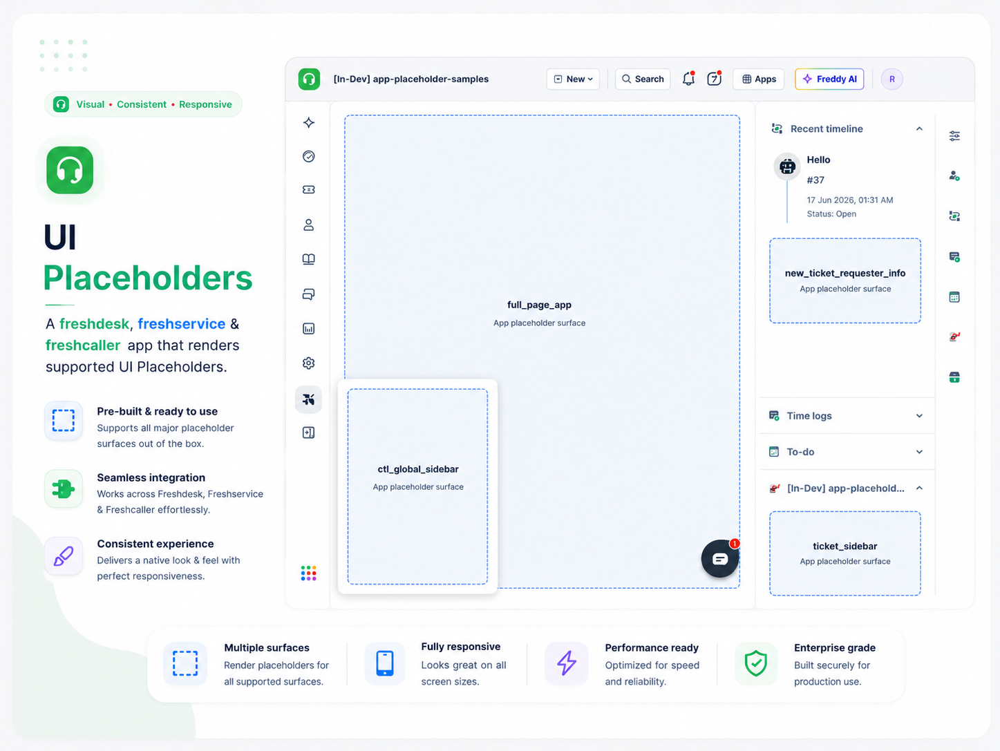

<p align="center">
  
</p>

# App Placeholder Samples

A Freshworks Platform 3.0 reference app that maps every supported **app placeholder** to a minimal HTML shell across **Freshdesk**, **Freshservice**, **Freshcaller**, and common modules — so developers can see where an app renders before building real UI or background logic.

## Description

Placeholders are the named regions on a Freshworks product page where your app can load. This sample declares **32 locations** in one `manifest.json`, each with a thin HTML entry that initializes the app client and logs `app.activated`. Use it as a visual catalog when planning multi-surface apps or validating manifest configuration during local development.

### Core Functionality

1. **Placeholder catalog** — one repo covers ticket, contact, company, email, change, asset, CTI, full-page, and Freshcaller surfaces.
2. **Minimal bootstrap** — every shell calls `app.initialized()` and listens for `app.activated` so you can confirm lifecycle wiring in the browser console.
3. **UI vs headless** — sidebar and full-page placeholders show labeled placeholder images; background placeholders render without agent-facing UI.

## User Interfaces

Surfaces are grouped by manifest module. Each row maps a placeholder to its HTML entry under `app/views/`.

### Common (all products)

| Surface | Placement | Behavior |
| --- | --- | --- |
| `app/views/global_sidebar/fullpage.html` | `common.full_page_app` | Full-page placeholder image |
| `app/views/global_sidebar/cti_global_sidebar.html` | `common.cti_global_sidebar` | CTI global sidebar placeholder |

### Freshdesk — `support_ticket`

| Surface | Placement | Behavior |
| --- | --- | --- |
| `app/views/ticket_details_page/ticket_sidebar.html` | `support_ticket.ticket_sidebar` | Ticket sidebar placeholder |
| `app/views/new_ticket_page/new_ticket_requester_info.html` | `support_ticket.ticket_requester_info` | Requester info region (Freshdesk ticket module) |
| `app/views/ticket_details_page/ticket_top_navigation.html` | `support_ticket.ticket_top_navigation` | Top navigation bar on ticket page |
| `app/views/ticket_details_page/ticket_attachment.html` | `support_ticket.ticket_attachment` | Attachments section placeholder |
| `app/views/ticket_details_page/ticket_conversation_editor.html` | `support_ticket.ticket_conversation_editor` | Reply/note editor placeholder |
| `app/views/ticket_details_page/ticket_background.html` | `support_ticket.ticket_background` | Headless — no UI, lifecycle only |
| `app/views/ticket_details_page/time_entry_background.html` | `support_ticket.time_entry_background` | Headless — log-time window background |

### Freshdesk — `support_email`

| Surface | Placement | Behavior |
| --- | --- | --- |
| `app/views/new_email_page/new_email_requester_info.html` | `support_email.new_email_requester_info` | New email requester info placeholder |
| `app/views/new_email_page/new_email_background.html` | `support_email.new_email_background` | Headless — new email background |

### Freshdesk — `support_contact` / `support_company`

| Surface | Placement | Behavior |
| --- | --- | --- |
| `app/views/contact_details_page/contact_sidebar.html` | `support_contact.contact_sidebar` | Contact detail sidebar |
| `app/views/contact_details_page/contact_background.html` | `support_contact.contact_background` | Headless — contact detail background |
| `app/views/contact_list_page/contact_list_background.html` | `support_contact.contact_list_background` | Headless — contact list background |
| `app/views/company_details_page/company_background.html` | `support_company.company_background` | Headless — company detail background |
| `app/views/company_list_page/company_list_background.html` | `support_company.company_list_background` | Headless — company list background |

### Freshservice — `service_ticket`

| Surface | Placement | Behavior |
| --- | --- | --- |
| `app/views/ticket_details_page/ticket_sidebar.html` | `service_ticket.ticket_sidebar` | Shared ticket sidebar shell (Freshservice) |
| `app/views/ticket_details_page/ticket_requester_info.html` | `service_ticket.ticket_requester_info` | Requester info on service ticket |
| `app/views/ticket_details_page/ticket_top_navigation.html` | `service_ticket.ticket_top_navigation` | Top navigation on service ticket |
| `app/views/ticket_details_page/ticket_background.html` | `service_ticket.ticket_background` | Headless — service ticket background |
| `app/views/new_ticket_page/new_ticket_sidebar.html` | `service_ticket.new_ticket_sidebar` | New ticket creation sidebar |
| `app/views/new_ticket_page/new_ticket_background.html` | `service_ticket.new_ticket_background` | Headless — new ticket background |

### Freshservice — `service_asset` / `service_change` / `service_user`

| Surface | Placement | Behavior |
| --- | --- | --- |
| `app/views/asset_details_page/asset_sidebar.html` | `service_asset.asset_sidebar` | Asset detail sidebar |
| `app/views/change_details_page/change_sidebar.html` | `service_change.change_sidebar` | Change detail sidebar |
| `app/views/change_details_page/change_background.html` | `service_change.change_background` | Headless — change detail background |
| `app/views/new_change_page/new_change_sidebar.html` | `service_change.new_change_sidebar` | New change sidebar |
| `app/views/new_change_page/new_change_background.html` | `service_change.new_change_background` | Headless — new change background |
| `app/views/contact_details_page/contact_sidebar.html` | `service_user.contact_sidebar` | User (contact) sidebar on Freshservice |

### Freshcaller — `caller_conversation` / `notification`

| Surface | Placement | Behavior |
| --- | --- | --- |
| `app/views/caller_conversation/conversation_card.html` | `caller_conversation.conversation_card` | Freshcaller web UI conversation card |
| `app/views/caller_conversation/widget_conversation_card.html` | `caller_conversation.widget_conversation_card` | Freshcaller widget conversation card |
| `app/views/notification/notification_card.html` | `notification.notification_card` | Freshcaller web UI notification card |
| `app/views/notification/widget_notification_card.html` | `notification.widget_notification_card` | Freshcaller widget notification card |

## Platform 3.0 Features Used

### 1. App Placeholders — Multi-Location Manifest

Each product module declares one or more `location` entries in `manifest.json`. A single app package can render in multiple regions simultaneously — for example `ticket_sidebar` plus `ticket_background` on the same ticket page.

```json
"support_ticket": {
  "location": {
    "ticket_sidebar": {
      "url": "views/ticket_details_page/ticket_sidebar.html",
      "icon": "styles/images/helicopter.svg"
    },
    "ticket_background": {
      "url": "views/ticket_details_page/ticket_background.html",
      "icon": "styles/images/aeroplane.svg"
    }
  }
}
```

### 2. App Client Initialization

Every shell loads the platform client and waits for activation:

```javascript
(async function init() {
  const client = await app.initialized();
  client.events.on('app.activated', () => {
    console.info('ticket_sidebar: app is activated');
  });
})();
```

### 3. Headless vs Visible Placeholders

Background placeholders (`ticket_background`, `contact_background`, `new_ticket_background`, etc.) run without agent UI — ideal for event listeners, Interface Methods, or server-triggered logic. Sidebar, navigation, editor, and full-page placeholders show labeled placeholder graphics so you can confirm layout and sizing during `fdk run`.

## Project Structure

```
├── app/
│   └── views/
│       ├── asset_details_page/
│       ├── caller_conversation/
│       ├── change_details_page/
│       ├── company_details_page/
│       ├── company_list_page/
│       ├── contact_details_page/
│       ├── contact_list_page/
│       ├── global_sidebar/
│       ├── new_change_page/
│       ├── new_email_page/
│       ├── new_ticket_page/
│       ├── notification/
│       └── ticket_details_page/
│   └── styles/
│       └── images/
│           ├── aeroplane.svg
│           ├── helicopter.svg
│           └── icon.svg
├── config/
│   └── iparams.json            # Empty — no installation parameters
├── manifest.json               # 32 placeholder locations across modules
├── usecase.md
└── README.md
```

## Prerequisites

- [Freshworks CLI (FDK)](https://developers.freshworks.com/docs/app-sdk/v3.0/support_ticket/basic-dev-tools/freshworks-cli/) v10.1.2 or later
- Node.js v24.x
- Trial accounts for the products you want to exercise (Freshdesk, Freshservice, and/or Freshcaller)

Enable global apps before local development:

```bash
fdk config set global_apps.enabled true
```

## Local Development

1. Clone the repository and enter the app directory:
   ```bash
   git clone <repo-url>
   cd app-placeholder-samples
   ```

2. Validate and run:
   ```bash
   fdk validate
   fdk run
   ```

3. Open the target product with `?dev=true` and navigate to the page that hosts each placeholder:

   | Product | Example URL |
   | --- | --- |
   | Freshdesk ticket | `https://your-domain.freshdesk.com/a/tickets/1?dev=true` |
   | Freshservice ticket | `https://your-domain.freshservice.com/a/tickets/1?dev=true` |
   | Full-page app | Admin → Apps → your full-page app entry |

4. Open the browser console on each surface and confirm the `app is activated` log for that placeholder name.

5. Trim unused modules from `manifest.json` when forked into a production app — you rarely need all 32 locations in one shipped package.

## Key Learnings

1. **One manifest, many surfaces** — placeholders are declared per module; reuse the same HTML URL across modules (for example `ticket_sidebar.html` for both `support_ticket` and `service_ticket`) when the UI is identical.
2. **Background + sidebar pairs** — combine `ticket_background` for headless rules with `ticket_sidebar` for agent controls on the same ticket page.
3. **Product-specific placeholders** — Freshdesk-only surfaces (`support_email`, `support_company`) and Freshservice-only surfaces (`service_change`, `service_asset`) cannot be validated on the wrong product account.

## Resources

- [App Placeholders](https://developers.freshworks.com/docs/app-sdk/v3.0/common/front-end-apps/placeholders/)
- [Manifest — modules and locations](https://developers.freshworks.com/docs/app-sdk/v3.0/common/app-manifest/)
- [App lifecycle events](https://developers.freshworks.com/docs/app-sdk/v3.0/common/front-end-apps/app-lifecycle/)
